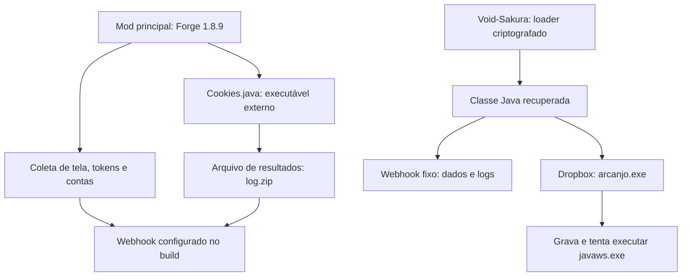

# MineDoMal

**Análise estática de um infostealer para Minecraft, seu builder em Discord e o loader criptografado Void-Sakura.**

Este documento reúne a análise do código-fonte, da automação de builds e das camadas recuperadas de `Void-Sakura-1.2.9.jar`. O objetivo é registrar comportamento, evidências e indicadores úteis para engenharia reversa, detecção e resposta a incidentes.

> **Classificação:** código de roubo de informações e carregamento de executáveis externos. A amostra deve ser tratada como maliciosa. A análise foi estática: nenhum mod, bot ou payload foi executado, e os executáveis remotos não foram baixados.

| Campo | Informação |
|---|---|
| Amostra de origem | `MineDoMal-main.zip` |
| Data desta consolidação | 04/10/2026 — America/Sao_Paulo |
| Componentes principais | Mod Java, bot Python e JAR ofuscado independente |
| Resultado central | Duas cadeias distintas de coleta/download/execução identificadas |
| Validação | Leitura de fontes, inspeção de bytecode, descriptografia estática e SHA-256 |
| Principal lacuna | Comportamento dos executáveis externos `chromium.exe` e `arcanjo.exe` |

## Sumário

- [Visão geral](#visão-geral)
- [Escopo e grau de certeza](#escopo-e-grau-de-certeza)
- [Estrutura e tecnologias](#estrutura-e-tecnologias)
- [Cadeia A — mod principal](#cadeia-a--mod-principal)
- [Bot e infraestrutura de builds](#bot-e-infraestrutura-de-builds)
- [Cadeia B — Void-Sakura](#cadeia-b--void-sakura)
- [Indicadores e hashes](#indicadores-e-hashes)
- [Detecção e investigação](#detecção-e-investigação)
- [Mapeamento MITRE ATT&CK](#mapeamento-mitre-attck)
- [Avaliação de engenharia](#avaliação-de-engenharia)
- [Resposta a uma possível execução](#resposta-a-uma-possível-execução)
- [Limitações e próximos passos](#limitações-e-próximos-passos)
- [Referências e licença](#referências-e-licença)
- [Apêndice — parâmetros criptográficos](#apêndice--parâmetros-criptográficos)

## Visão geral

O nome `MineDoMal` identifica o conjunto recebido. No projeto Java principal, os identificadores `abysrat` e `AbysRAT` aparecem em metadados, logs e mensagens. O nome, por si só, não demonstra a existência de um RAT completo.

A classificação sustentada pelo material analisado é:

| Componente | Papel observado |
|---|---|
| `src/main/java/dev/nfo/` | Infostealer: captura de tela, coleta de tokens, sessões, arquivos de contas e códigos de recuperação |
| `Cookies.java` | Downloader/executor de um programa externo e envio do arquivo de resultados esperado |
| `discord-bot/` | Controle de acesso ao builder, personalização e entrega de JARs pelo Discord |
| `Void-Sakura-1.2.9.jar` | Loader criptografado com carregamento de classes em memória |
| Classe final do Void-Sakura | Identificação do ambiente, envio de logs, download e tentativa de execução de um EXE |

**Há duas cadeias distintas no ZIP.** A cadeia do código-fonte principal usa `chromium.exe`; a do Void-Sakura referencia `arcanjo.exe`, salvo localmente como `javaws.exe`. Não foi estabelecido que os dois executáveis sejam iguais, pertençam à mesma família ou tenham o mesmo operador.



O código contém rotinas concretas de coleta e execução, mas **análise estática não comprova que todas funcionem em um sistema atual**. Compatibilidade, configuração, permissões, conectividade, disponibilidade dos serviços e proteções do endpoint podem impedir partes do fluxo.

## Escopo e grau de certeza

Foram examinados os fontes Java e Python, arquivos de configuração, artefatos de build selecionados, metadados do JAR e classes recuperadas por descriptografia. A cadeia criptográfica foi reproduzida sem invocar os métodos das classes analisadas.

| Tipo de evidência | Como deve ser interpretado |
|---|---|
| Confirmado no código ou bytecode | A implementação ou referência existe na amostra |
| Confirmado por hash | Os bytes examinados correspondem exatamente ao artefato identificado |
| Inferência analítica | Interpretação coerente com as evidências, sem comprovação independente de intenção ou autoria |
| Não avaliado | Depende de material externo, execução ou telemetria ausente |

O material permite afirmar que há funções para roubo de dados e execução de binários. Não permite afirmar que houve uma vítima, exfiltração bem-sucedida, persistência, movimentação lateral ou comprometimento de uma máquina específica.

Os caminhos deste README são relativos à raiz do conteúdo de `MineDoMal-main/`, salvo indicação em contrário. Endereços potencialmente operacionais aparecem desarmados, com `hxxps` e `[.]`. Tokens de webhook e links privados completos não são reproduzidos.

## Estrutura e tecnologias

O ZIP contém **174 arquivos**, totalizando **10.294.521 bytes descompactados**, sem contar entradas de diretório. Esse total inclui duplicações e artefatos gerados.

| Caminho | Conteúdo e relevância |
|---|---|
| `src/main/java/dev/nfo/MainMod.java` | Registro do mod e inicialização dos handlers |
| `src/main/java/dev/nfo/handlers/` | Módulos de Discord, cookies, Minecraft, screenshot e backup codes |
| `src/main/java/dev/nfo/utils/Utils.java` | Rotinas auxiliares de criptografia e DPAPI |
| `src/main/resources/mcmod.info` | Metadados do mod principal |
| `build.gradle` e `settings.gradle` | Configuração Java/Forge e identificação `abysrat` |
| `discord-bot/main.py` | Inicialização do bot, conexão MongoDB e carregamento de comandos |
| `discord-bot/commands/` | `createkey.py`, `redeem.py` e `build.py` |
| `build/` | Fontes transformados, classes, logs e arquivos temporários de compilação |
| `jar-stealer-main/` | Cópia do projeto principal e artefatos adicionais |
| `stealermod-minecraft-main/Void-Sakura-1.2.9.jar` | Loader ofuscado analisado separadamente |
| `stealermod-minecraft-main/Void-Sakura-1.2.9/` | Conteúdo expandido do JAR, incluindo classes e metadados |

### Dois alvos de compatibilidade

| Aspecto | Mod principal | Void-Sakura |
|---|---|---|
| Identificador | `abysrat` | `voidmod` |
| Versão declarada | `1.0` | `1.0.0` nos metadados |
| Minecraft | `1.8.9` | Intervalo declarado `[1.21.1,)` |
| Forge | `1.8.9-11.15.1.2318-1.8.9` | Loader/dependência declarados `[52,)` |
| Java | Compatibilidade de compilação `1.8` | Classe final com major version `65`, correspondente a Java 21 |
| Configuração | `build.gradle` e `mcmod.info` | `META-INF/mods.toml` |

O nome de arquivo `Void-Sakura-1.2.9.jar` difere da versão interna `1.0.0`. Os intervalos declarados no TOML não foram testados como garantia de compatibilidade com todas as versões posteriores.

O projeto principal referencia ForgeGradle `2.1-SNAPSHOT`, Gson `2.8.0` e JNA Platform `5.2.0`. O bot usa Python 3, `discord.py`, `pymongo` e `python-dotenv`. Essas são dependências declaradas na amostra, não recomendações de instalação.

## Cadeia A — mod principal

### Inicialização automática

`MainMod.init(FMLInitializationEvent)` é acionado durante a inicialização do Forge em ambiente compatível. O método tenta ajustar restrições criptográficas da JVM, captura a tela e inicia threads para os demais handlers.

| Ordem no inicializador | Ação |
|---|---|
| 1 | `Utils.bypassKeyRestriction()` |
| 2 | `Screenshot.captureAndSend()` |
| 3 | Thread para `Discord.sendTokens()` |
| 4 | Thread para `Cookies.downloadAndExecute()` |
| 5 | Thread para `Minecraft.collectAndSend()` |
| 6 | Thread para `BackupCodes.searchAndSend()` |

Essa é a ordem das chamadas/inicializações; as threads não têm ordem garantida de conclusão. Não há necessidade de um botão adicional dentro do mod para iniciar essas rotinas. Apenas possuir ou descompactar o ZIP não equivale a carregar o mod.

### Captura de tela

`Screenshot.java` utiliza `java.awt.Robot` para capturar a área de tela obtida pelo AWT. A imagem é codificada como JPEG, com qualidade configurada em `0.3`, e enviada ao webhook por `multipart/form-data`, sob o nome `screenshot.jpg`.

O fluxo mantém a imagem em memória antes do envio; esse nome de anexo não comprova a criação de um arquivo homônimo no disco.

### Discord e tokens de sessão

`Discord.java` procura dados em diretórios de armazenamento LevelDB de clientes Discord e de diversos navegadores baseados em Chromium. A implementação contempla dados em texto e um caminho para dados criptografados.

`Utils.java` lê informações de `Local State`, chama DPAPI pela JNA e implementa descriptografia AES-GCM. Isso descreve o mecanismo presente no código, sem afirmar compatibilidade com todos os formatos atuais de armazenamento.

As rotinas também tentam validar tokens e obter informações da conta pela API do Discord. A composição das mensagens inclui token, identificação da conta, e-mail, estado de MFA, informações de perfil, referências a cobrança, nome de usuário local e hostname.

As chamadas relacionadas a cobrança não demonstram obtenção de números completos de cartão. O resultado efetivo depende da API, das permissões e da validade dos tokens.

**Evidência principal:** `Discord.sendTokens()`, `crawl()`, `validateTokens()`, `sendTokenEmbed()`, `getBilling()`, `Utils.getKey()` e `Utils.decrypt()`.

### Minecraft, Lunar Client e Essential

`Minecraft.collectAndSend()` reúne informações de sessão e arquivos locais. O código tenta obter:

| Origem | Dados procurados |
|---|---|
| Sessão do cliente Minecraft | Username, UUID e token da sessão |
| Lista de servidores do cliente | Nomes e endereços, conforme disponibilidade no objeto consultado |
| `launcher_profiles.json` | Perfis e campos de autenticação esperados pelo código |
| `options.txt` | Uma entrada de username, caso exista no formato procurado |
| Lunar Client | Conteúdo do arquivo de contas, convertido para Base64 |
| Essential | Conteúdo do arquivo de contas Microsoft, convertido para Base64 |

O token da sessão atual é incluído na mensagem. Já um `accessToken` de perfil do launcher é truncado na formatação quando ultrapassa 50 caracteres. A coleta tentada e o conteúdo efetivamente formatado para envio, portanto, não são idênticos em todos os campos.

Base64 nos arquivos de Lunar/Essential é apenas codificação reversível, não proteção criptográfica. Caminhos e esquemas de arquivo esperados pela implementação podem não corresponder a instalações atuais.

### Códigos de recuperação do Discord

`BackupCodes.searchForBackupCodes()` procura especificamente `discord_backup_codes.txt` em `Downloads`, `Desktop` e `Documents`, abaixo do diretório do usuário.

A busca implementada não é uma varredura recursiva de todo o disco. O primeiro arquivo encontrado e lido é retornado para composição da mensagem ao webhook. A presença desse arquivo, isoladamente, é legítima e não constitui indicador de infecção.

### Executável externo e arquivo de resultados

Apesar do nome `Cookies.java`, essa classe não contém toda a implementação de extração de cookies. Ela delega trabalho a um programa obtido de uma origem externa.

| Etapa | Comportamento implementado |
|---|---|
| Origem | GET para `hxxps://infect[.]k4ss[.]lol/bps` |
| Destino | `chromium.exe` em `java.io.tmpdir` |
| Verificação local | Resposta HTTP, existência e tamanho não nulo do arquivo |
| Execução | `ProcessBuilder` apontando para o executável salvo |
| Sincronização | Espera o processo terminar por `waitFor()` |
| Resultado esperado | `%LOCALAPPDATA%\lol\log.zip` |
| Espera adicional | Até 60 verificações com intervalo de um segundo pela existência do ZIP |
| Envio | Upload de `log.zip` ao webhook |
| Limpeza | Tentativa de excluir o executável e o ZIP após a rotina de envio |

A espera de 60 segundos refere-se à procura pelo ZIP, **depois** de `waitFor()`. Ela não limita o tempo total de execução do programa externo.

O código não verifica uma assinatura do publicador nem um hash esperado do payload. Existência e tamanho não nulo não demonstram autenticidade. A origem remota determina os bytes que serão executados naquele momento.

Não foi obtida uma amostra desse EXE. Portanto, o conteúdo de `log.zip`, as técnicas empregadas pelo programa e a extensão real da coleta continuam desconhecidos. A tentativa de exclusão também não comprova entrega bem-sucedida ao webhook nem remoção completa dos arquivos.

## Bot e infraestrutura de builds

O bot funciona como uma camada de acesso e distribuição para variantes do mod principal. A presença desse código não comprova que um serviço comercial esteja ativo.

| Componente | Função observada |
|---|---|
| `main.py` | Lê configuração de ambiente, conecta ao MongoDB e carrega os comandos |
| `createkey.py` | Gera chaves de acesso, com verificação de IDs autorizados |
| `redeem.py` | Vincula uma chave existente a uma conta Discord |
| `build.py` | Verifica vínculo, personaliza fontes, invoca Gradle e entrega o JAR |
| MongoDB | Usa o banco `abysrat_bot` e a coleção `keys` |

Os comandos `/createkey`, `/redeem` e `/build` são registrados como slash commands. A configuração faz referência a `DISCORD_TOKEN`, `MONGODB_URI` e `AUTHORIZED_IDS`; seus nomes ajudam a identificar a arquitetura, sem expor valores de acesso.

O builder substitui `%NAME%` e `%WEBHOOK%` nos arquivos do projeto, inicia a compilação, tenta restaurar os placeholders e envia o artefato pelo Discord. Há um `asyncio.Lock` para serializar builds dentro da instância do processo.

### Interpretação correta do sistema de chaves

`createkey.py` inicializa campos como `used`, `used_by` e `used_at`. O resgate utiliza `redeemed_by` e `redeemed_at`. A autorização de build consulta o vínculo `redeemed_by` e permite reutilização da chave.

O comentário do código declara explicitamente builds ilimitadas. Esse comportamento é uma decisão implementada, não prova isolada de falha de autorização. Nos comandos examinados, não há fluxo explícito de expiração ou revogação, cota por usuário ou trilha completa de auditoria.

O bot é infraestrutura de geração/entrega. Não foi identificado nele um canal para enviar comandos interativos aos computadores que carregam o mod.

## Cadeia B — Void-Sakura

### Entrada pelo Forge

O JAR contém `me.void_.void_.forge.voidForge`, que registra um listener de setup do cliente. O caminho de `onClientSetup()` chega a `voidVoiceBetaClient1.initialize()`.

O bootstrap está, portanto, ligado ao ciclo de vida do mod. Não foi necessário executar o Forge para confirmar essa referência no bytecode.

### Visão das camadas

| Camada | Entrada | Transformação observada | Saída |
|---|---|---|---|
| Loader externo | Quatro constantes Base64 | Decodificação, concatenação e AES-256-GCM | Contêiner binário de 15.420 bytes |
| Classes intermediárias | Blob interno de 4.574 bytes | AES-256-GCM e, depois, XOR `0xBB` | `Stub.class` e `Stub$CL.class` |
| Payload Java | Uma entrada de mapa codificada | Base64, XOR `0xBB` e, depois, AES-256-GCM | `voidVoiceBetaClient.class` |
| Ativação | Classe recuperada | Carregamento em memória e chamada reflexiva | Método `initialize()` |
| Programa externo | URL embutida no payload Java | Download para diretório temporário e tentativa de execução | `javaws.exe` |

As duas operações que combinam AES e XOR usam **ordens diferentes**. A tabela preserva essa distinção. A última linha descreve a implementação do downloader; os bytes do programa externo não foram coletados.

### Primeira camada: quatro fragmentos, um único conteúdo cifrado

Os quatro blobs Base64 de `voidVoiceBetaClient1` decodificam para:

| Fragmento | Tamanho decodificado |
|---|---:|
| 1 | 4.000 bytes |
| 2 | 4.000 bytes |
| 3 | 4.000 bytes |
| 4 | 3.448 bytes |
| Total | **15.448 bytes** |

O loader concatena os fragmentos. Os 12 primeiros bytes formam o nonce GCM; a chave AES de 256 bits está embutida na classe. A descriptografia autenticada produz o contêiner de 15.420 bytes.

O contêiner inclui um inteiro inicial com valor `1`, uma segunda chave AES, o byte XOR `0xBB`, um blob cifrado das classes intermediárias e um mapa com o payload seguinte. O inteiro inicial é lido e descartado pelo loader; sua função como versão ou magic number não está documentada.

### Classes intermediárias

O blob de 4.574 bytes inclui nonce, conteúdo cifrado e tag GCM. Depois da descriptografia e do XOR, o resultado contém duas classes válidas:

| Classe | Tamanho | Responsabilidade |
|---|---:|---|
| `Stub` | 3.587 bytes | Decodificar/descriptografar as entradas do payload e acionar a classe-alvo |
| `Stub$CL` | 934 bytes | Resolver classes a partir de um mapa de bytecode |

Essas classes não são o executável externo. Elas compõem o mecanismo de carregamento do próximo estágio Java.

### O papel de `Stub.r()`

O método público recebe quatro argumentos declarados como `Object`. A interpretação observada é:

| Argumento | Conteúdo esperado |
|---|---|
| Payloads | Mapa entre nomes de classes e strings com conteúdo codificado |
| Key | Segunda chave AES de 32 bytes |
| XOR | Byte `0xBB` |
| Target class | `me.void_.void_.common.voidVoiceBetaClient` |

Para cada entrada do mapa, o método aplica Base64, XOR e AES-GCM, recuperando bytecode Java. Em seguida, instancia `Stub$CL`, solicita a classe-alvo e invoca seu método de inicialização por reflexão.

`Stub$CL.findClass()` utiliza `defineClass()` sobre os bytes em memória. A implementação analisada não precisa gravar a classe final em disco para carregá-la. Isso não torna a cadeia inteira “sem arquivos”: o EXE posterior é salvo no diretório temporário.

### Classe final recuperada

| Propriedade | Valor |
|---|---|
| Nome completo | `me.void_.void_.common.voidVoiceBetaClient` |
| Tamanho | **8.038 bytes** |
| Assinatura inicial | `CA FE BA BE` |
| Major version | `65` — Java 21 |
| SHA-256 | `409edde0f5184b9afbe9cbcc0f57863bac2bb9885feae083659420c95a4299fa` |

`initialize()` cria uma thread. O corpo dessa thread chama, em sequência, `sendLogsToWebhook()` e `downloadAndExecute()`.

| Método | Comportamento |
|---|---|
| `sendLogToWebhook(String)` | Envia uma mensagem JSON ao webhook fixo |
| `sendLogsToWebhook()` | Obtém username, sistema operacional, arquitetura e versão Java |
| `downloadAndExecute()` | Define o arquivo de destino e coordena download/execução |
| `downloadFile(String, String)` | Baixa o conteúdo e registra progresso |
| `formatBytes(long)` | Formata tamanhos para mensagens de progresso |
| `executeFile(String)` | Seleciona o caminho de execução conforme o sistema operacional |

### Beacon e logs

A classe consulta as propriedades `user.name`, `os.name`, `os.arch` e `java.version`, e tenta enviá-las a um webhook hardcoded em `canary.discord.com`.

A mensagem inicial identifica uma nova execução do mod. Outras mensagens registram progresso de download e execução. Isso sustenta a descrição **beacon de execução e canal de logs**. Não foi encontrada nessa classe uma rotina de consulta de comandos recebidos do webhook.

O envio de logs usa timeouts de conexão e leitura de **5 segundos**. O token completo do webhook permanece omitido deste documento.

### Downloader e execução do EXE

| Parâmetro | Valor observado |
|---|---|
| Host remoto | `www.dropbox[.]com` |
| Nome no recurso remoto | `arcanjo.exe` |
| Nome local | `javaws.exe` |
| Diretório local | `System.getProperty("java.io.tmpdir")` |
| Método HTTP | GET |
| Timeout de conexão | 10 segundos |
| Timeout de leitura | 120 segundos |
| Buffer | 262.144 bytes — 256 KiB |
| Progresso sem tamanho total conhecido | Atualizações em incrementos de aproximadamente 2 MiB |
| User-Agent | `Mozilla/5.0 (Windows NT 10.0; Win64; x64) AppleWebKit/537.36` |

No Windows, `executeFile()` constrói um processo com `cmd.exe`, `/c` e `start`, apontando para o arquivo temporário. Em outros sistemas, tenta marcar o arquivo como executável e iniciá-lo diretamente. Essa ramificação não comprova que o programa remoto seja compatível com Linux ou macOS.

O nome `javaws.exe` é compatível com uma tentativa de aparentar um componente Java; isso é uma inferência sobre o nome, não uma atribuição comprovada de intenção. Um arquivo legítimo homônimo não deve ser classificado apenas pelo nome.

O resultado observado é **loader criptografado, beacon, downloader e executor**. O comportamento após o início do EXE permanece fora do que este JAR permite determinar.

## Indicadores e hashes

### Identificação exata dos artefatos

Os hashes abaixo foram recalculados durante a consolidação. Os hashes das classes intermediárias e final correspondem aos bytes recuperados estaticamente, não a arquivos originalmente visíveis na raiz do JAR.

| Artefato | SHA-256 |
|---|---|
| `MineDoMal-main.zip` | `4e959d0a61900c1657f401701b2bccfede1ec9447fa8ab7f0c90380b91ea4135` |
| `Void-Sakura-1.2.9.jar` — 22.357 bytes | `7a788cdc3ecfaaaf507320ff318398c2f1785753e39ecce85aca666d78b40745` |
| `Stub.class` | `685007c696417cdb209511b6263204cb0e4859e1357ee67179a10d98d4b9a6fd` |
| `Stub$CL.class` | `735cdd3ebabe38a92dccdf3180aac920fcc9482e6b4921168949d4c630e93e7b` |
| `voidVoiceBetaClient.class` | `409edde0f5184b9afbe9cbcc0f57863bac2bb9885feae083659420c95a4299fa` |

Não há hash confirmado de `arcanjo.exe`, `javaws.exe` ou `chromium.exe`, pois esses executáveis externos não foram obtidos. O hash do ZIP identifica o pacote específico recebido e muda se ele for recompactado ou alterado.

### Rede

| Indicador desarmado | Relação com a amostra | Limite de interpretação |
|---|---|---|
| `hxxps://infect[.]k4ss[.]lol/bps` | Origem fixa do download em `Cookies.java` | Referência estática; disponibilidade e conteúdo atual não verificados |
| `canary.discord[.]com/api/webhooks/[REDACTED]` | Webhook fixo da classe recuperada | Domínio compartilhado legítimo; token/ID omitidos |
| `www.dropbox[.]com` + recurso `arcanjo.exe` | Origem externa no Void-Sakura | Domínio legítimo e pouco específico sem contexto adicional |
| `discord[.]com/api/v9/users/@me` e rotas correlatas | Consultas do handler Discord | API legítima; a finalidade vem do contexto do processo e do código |
| Webhook do mod principal | Valor inserido pelo builder | Pode variar entre builds; não deve ser presumido igual ao do Void-Sakura |

Domínios de serviços amplamente usados não são, sozinhos, evidência suficiente de comprometimento. A mesma cautela vale para o endpoint de API do Discord.

### Arquivos, nomes e strings

| Indicador | Uso investigativo |
|---|---|
| `%TEMP%\chromium.exe` | Destino típico do primeiro downloader no Windows |
| `%LOCALAPPDATA%\lol\log.zip` | Resultado esperado para envio pelo handler `Cookies` |
| `%TEMP%\javaws.exe` | Destino típico do downloader do Void-Sakura |
| `screenshot.jpg` | Nome do anexo de captura de tela |
| `AbysRAT/1.0` | User-Agent de rotinas de exfiltração do mod principal |
| `Abys Private Edition` | String presente em mensagens do mod principal |
| `me.void_.void_.common.voidVoiceBetaClient1` | Classe externa do loader |
| `me.void_.void_.common.voidVoiceBetaClient` | Classe oculta final |
| `Stub` e `Stub$CL` | Nomes intermediários genéricos; exigir combinação com outros sinais |

`%TEMP%` é uma representação habitual no Windows. O código usa `java.io.tmpdir`, que pode apontar para outro diretório. Arquivos de contas e códigos de recuperação são **alvos de coleta**, não artefatos necessariamente criados pelo malware.

## Detecção e investigação

A melhor base para investigação é a combinação de identidade do arquivo, processo de origem, gravações e atividade de rede. Um nome de arquivo ou domínio isolado tem baixa especificidade.

| Prioridade | Hipótese de detecção | Evidências para correlação |
|---|---|---|
| Alta | Presença do JAR exato | SHA-256, caminho de armazenamento, origem do download e histórico do launcher |
| Alta | Java grava e inicia EXE temporário | Processo Java do jogo, criação de `chromium.exe`/`javaws.exe` e eventos subsequentes de processo |
| Alta | Cadeia Java, shell do Windows e EXE temporário | Linha de comando, árvore de processos, caminho, hash e assinatura do executável |
| Alta | Envio de resultado de coleta | Acesso a `lol\log.zip` seguido de conexão do mesmo processo a webhook |
| Média | Leitura de dados de outras aplicações pelo jogo | Acessos a LevelDB, `Local State` e arquivos de contas, quando a telemetria permitir |
| Média | Downloader do Void-Sakura | Conexão a Dropbox, gravação de `javaws.exe` e logs para Discord próximos no tempo |
| Apoio | Strings/classes do loader | Inspeção estática de JARs/classes e análise de memória, quando disponível |

Essas são hipóteses de hunting derivadas do código, não regras de detecção testadas em produção. A árvore real de processos e o acesso a URLs completas dependem da instrumentação. Sem inspeção HTTP/TLS adequada, a telemetria pode mostrar apenas o host ou o destino da conexão.

Aplicações Java legítimas podem usar criptografia, reflexão e classloaders. A presença de AES-GCM, Base64 ou `defineClass()` isoladamente não é suficiente. Nesta amostra, a sequência que culmina em download e execução do EXE é o contexto decisivo.

### Conferência de identidade sem execução

Para comparar uma cópia local com os hashes documentados, é suficiente ler seus bytes:

```bash
sha256sum MineDoMal-main.zip
sha256sum Void-Sakura-1.2.9.jar
```

No PowerShell:

```powershell
Get-FileHash -Algorithm SHA256 -LiteralPath .\Void-Sakura-1.2.9.jar
```

Esses comandos calculam hashes; não carregam o mod. Um nome diferente não altera a identidade se o conteúdo e o SHA-256 forem os mesmos.

## Mapeamento MITRE ATT&CK

O enquadramento abaixo é uma interpretação analítica das funções presentes na amostra. Não comprova execução em uma vítima, nem atribui o material a um grupo descrito na base ATT&CK.

| Técnica | Evidência na amostra |
|---|---|
| [T1113 — Screen Capture](https://attack.mitre.org/techniques/T1113/) | Captura de tela com AWT e preparação de anexo JPEG |
| [T1528 — Steal Application Access Token](https://attack.mitre.org/techniques/T1528/) | Rotinas de coleta de tokens de aplicações e sessão |
| [T1140 — Deobfuscate/Decode Files or Information](https://attack.mitre.org/techniques/T1140/) | Decodificação/descriptografia das camadas do Void-Sakura |
| [T1105 — Ingress Tool Transfer](https://attack.mitre.org/techniques/T1105/) | Download de executáveis adicionais |
| [T1059.003 — Windows Command Shell](https://attack.mitre.org/techniques/T1059/003/) | Uso de `cmd.exe` no caminho Windows da classe final |
| [T1567.004 — Exfiltration Over Webhook](https://attack.mitre.org/techniques/T1567/004/) | Envio de dados e anexos a webhooks |

Não foi atribuído mapeamento de persistência, keylogging, ransomware ou movimentação lateral: faltam evidências dessas capacidades no escopo examinado. O nome `Cookies.java` também não basta para atribuir ao EXE não coletado uma técnica específica de roubo de cookies.

## Avaliação de engenharia

A separação em handlers facilita a leitura do código principal. O bot apresenta uma organização simples por comandos e alguns controles explícitos. Ao mesmo tempo, o pacote reúne código-fonte, duplicatas, estado de compilação e binários com origens diferentes, o que dificulta rastreabilidade.

| Achado | Evidência e consequência para a análise |
|---|---|
| Duplicação | `src/` e `discord-bot/` são idênticos, byte a byte, às respectivas árvores em `jar-stealer-main/`: 8 e 9 arquivos comparados |
| Artefatos de compilação no pacote | `build/` contém classes, fontes transformados, JARs temporários e logs; não se deve presumir equivalência de todos com o fonte atual |
| Configuração embutida em artefatos | Um `MainMod.java` gerado em `build/sources/` contém webhook configurado, enquanto o fonte principal usa placeholder; valores omitidos aqui |
| Exclusões limitadas | O `.gitignore` cobre principalmente arquivos de ambiente, não o conjunto de resíduos encontrado |
| Erros tratados de forma inconsistente | Há blocos `catch` vazios e outras rotinas que imprimem erros; ausência de mensagem não comprova ausência de tentativa |
| Fontes compartilhados durante o build | O builder modifica e restaura arquivos da mesma árvore; o lock é local ao processo |
| Entrada externa em geração de fontes | Nome e webhook são inseridos por substituição textual, sem uma fronteira robusta de validação visível no trecho analisado |
| Dependência de executáveis remotos | O comportamento final pode mudar sem alteração do JAR local |
| Verificação limitada dos downloads | Existência/tamanho não vinculam o EXE a uma versão ou publicador esperado |

Para organizar um acervo defensivo, faz sentido separar fontes de referência, amostras em quarentena, evidências derivadas e documentação. O original deve manter seu hash e histórico. Excluir todos os `*.jar` indiscriminadamente seria inadequado: o pacote também contém `gradle-wrapper.jar`, que tem função distinta de uma amostra suspeita.

**Avaliação geral:** o código principal é fácil de inspecionar; o Void-Sakura adiciona camadas que escondem strings e bytecode de uma leitura superficial. Isso aumenta o esforço de análise, mas não demonstra sofisticação global, autoria específica ou capacidade comprovada de evitar antivírus/EDR.

## Resposta a uma possível execução

Esta seção se aplica a uma máquina que tenha carregado o mod ou iniciado os executáveis, não à simples posse do arquivo ZIP.

1. **Conter a máquina afetada.** Interromper sua comunicação conforme o procedimento de resposta adotado e evitar continuar usando sessões sensíveis nela.
2. **Preservar evidências.** Guardar amostras, hashes, logs do launcher, registros de rede e eventos de processos antes de uma limpeza que destrua a linha do tempo.
3. **Revisar sessões e acessos a partir de outro dispositivo confiável.** Priorizar Discord, contas Microsoft/Minecraft e outras contas potencialmente expostas pelo conteúdo da tela ou por payloads posteriores.
4. **Revogar sessões e renovar material de recuperação conforme o serviço.** Se backup codes foram expostos, gerar novos códigos; trocar senha isoladamente pode não encerrar todos os acessos.
5. **Investigar os EXEs e sua execução.** Preservar os bytes encontrados e examinar telemetria para determinar o alcance além do estágio Java.
6. **Definir a recuperação com base no alcance.** Remover o mod não comprova que os efeitos de um programa externo tenham sido revertidos. Reinstalação a partir de mídia confiável pode ser necessária quando não for possível delimitar o comprometimento.

Não há evidência, nesta análise, de que a máquina de quem recebeu o ZIP esteja infectada.

## Limitações e próximos passos

### O que está estabelecido

- O mod principal contém rotinas para coletar dados sensíveis e enviá-los a webhook.
- `Cookies.java` implementa download, execução de EXE e envio de um ZIP de resultados esperado.
- O bot possui funções de personalização, compilação e entrega de JARs.
- As árvores `src/` e `discord-bot/` comparadas têm duplicatas idênticas no pacote.
- O Void-Sakura contém uma cadeia de classes criptografadas acionada pelo ciclo do Forge.
- A cadeia foi recuperada estaticamente até uma classe Java válida de 8.038 bytes.
- Essa classe implementa identificação do ambiente, envio de logs e download/execução de um programa externo.
- Os hashes centrais e os parâmetros criptográficos registrados foram confirmados novamente.

### O que permanece desconhecido

- Conteúdo, hash, assinatura, família e capacidades dos EXEs remotos.
- Disponibilidade atual das URLs e dos webhooks.
- Persistência, coleta adicional, keylogging, controle remoto ou outras ações após o EXE.
- Existência de vítimas, sucesso de exfiltração ou atividade real do builder.
- Autor, operador, procedência legítima dos nomes e relação entre as duas cadeias.
- Compatibilidade prática com versões atuais de clientes, APIs e sistemas operacionais.
- Conteúdo integral de arquivos RAR aninhados e equivalência de todos os artefatos compilados com os fontes.

### Próximas etapas defensivas

| Prioridade | Trabalho | Resultado esperado |
|---|---|---|
| 1 | Examinar uma amostra de EXE já obtida por canal de resposta autorizado | Determinar o estágio que ainda falta, preservando origem e hash |
| 2 | Correlacionar telemetria de um endpoint potencialmente afetado | Distinguir presença, tentativa e execução efetiva |
| 3 | Comparar artefatos compilados e arquivos aninhados | Identificar divergências de código e configuração |
| 4 | Produzir e validar detecções em ambiente de análise | Medir cobertura e falsos positivos |
| 5 | Consolidar linha do tempo e cadeia de custódia | Permitir revisão independente das conclusões |

Não é necessário visitar as URLs de payload nem enviar mensagens aos webhooks para compreender ou utilizar este README.

## Referências e licença

### Fontes primárias da análise

| Fonte | Assunto sustentado |
|---|---|
| `MainMod.java` e `handlers/*.java` | Inicialização, coleta, envio e downloader da cadeia A |
| `utils/Utils.java` | Mecanismo criptográfico auxiliar e DPAPI |
| `discord-bot/main.py` e `commands/*.py` | Arquitetura do bot, chaves, personalização e build |
| `build.gradle`, `settings.gradle`, `mcmod.info` | Identidade e dependências do projeto principal |
| `Void-Sakura-1.2.9.jar` e `META-INF/mods.toml` | Classes originais, entrada Forge e metadados |
| Bytecode recuperado de `Stub`, `Stub$CL` e `voidVoiceBetaClient` | Cadeia criptográfica, carregamento e downloader da cadeia B |
| Páginas oficiais MITRE ATT&CK vinculadas na tabela | Nomenclatura das técnicas; o mapeamento é interpretação desta análise |

Não foi localizado um arquivo `LICENSE` ou `COPYING` na árvore extraída do ZIP. O `mods.toml` do Void-Sakura contém a declaração `license="MIT"`; essa declaração é um metadado daquele componente e não estabelece, por si só, a licença de todo o conjunto. Este README não acrescenta uma licença ao código ou aos binários recebidos.

## Apêndice — parâmetros criptográficos

Os valores abaixo são **constantes de proteção do conteúdo da amostra**, não credenciais de contas. Servem para identificar e conferir a cadeia específica analisada. Não devem ser confundidos com tokens do Discord ou chaves recuperadas de uma máquina afetada.

| Parâmetro | Valor |
|---|---|
| Transformação Java | `AES/GCM/NoPadding` |
| Tamanho das chaves | 32 bytes — AES-256 |
| Tamanho do nonce | 12 bytes |
| Tag GCM | 128 bits |
| Nonce da camada externa | `3e41d4686bde840e34af07a3` |
| Nonce do blob intermediário | `ea13d80ee397a3d8b3d0ea5e` |
| Byte XOR | `0xBB` |
| Inteiro inicial do contêiner | `1`, lido e descartado |
| Classes intermediárias | 2 |
| Entradas de payload final | 1 |

**Chave AES da camada externa — hexadecimal:**

```text
b3e02f07955082907fe3b117b8f08b724f1fc97bc5314ff1be5cf6087c835736
```

**Chave AES interna — hexadecimal:**

```text
b972b7044a6b7110bd0a897b6ece694a06e6df75c845da8684b0703224370501
```

A recuperação validou as tags GCM e produziu classes com estrutura e hashes consistentes. Isso demonstra consistência da extração estática; não transforma o conteúdo recuperado em software confiável.
